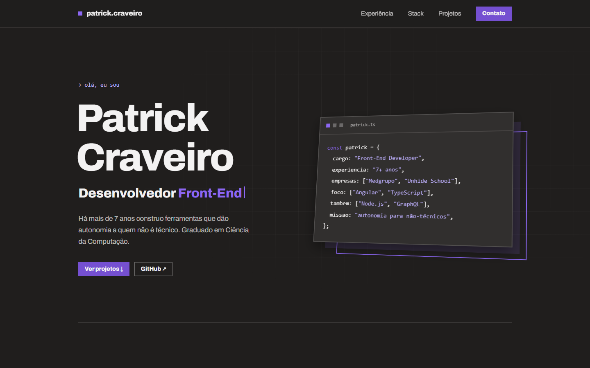

# Patrick Craveiro — Portfólio

Portfólio pessoal de desenvolvedor Full Stack, feito em Angular.

**🔗 [patrickcraveiro.github.io](https://patrickcraveiro.github.io/)**



## Destaques

- **Angular 22** com componentes standalone, signals, change detection `OnPush` e sem Zone.js.
- **Conteúdo separado do layout**: perfil, experiência, stack e projetos ficam em arquivos TypeScript tipados em [`src/app/data`](src/app/data).
- **Animações sem biblioteca**:
  - diretiva `appReveal`: entrada no scroll com um único `IntersectionObserver` compartilhado;
  - diretiva `appTilt`: inclinação 3D que segue o cursor;
  - efeito de digitação, cartão de código 3D e timeline que se preenche com o scroll.
- **Acessibilidade**: respeita `prefers-reduced-motion`, tem foco visível, link para pular ao conteúdo, contraste AA e textos alternativos para leitores de tela.
- **Design system** em tokens CSS: a cor de destaque é gerada em OKLCH a partir de uma única variável (`--accent-hue`).
- **Deploy automático** no GitHub Pages a cada push na `main`.

## Rodando localmente

Requer Node.js 22.22+ ou 24.15+.

```bash
npm install
npm start        # http://localhost:4200
npm run build    # gera dist/portfolio/browser
```

## Atualizando o conteúdo

Todo o texto do site está em [`src/app/data`](src/app/data):

| Arquivo | O que tem |
| --- | --- |
| `profile.ts` | Nome, resumo, e-mail, links e as palavras do efeito de digitação |
| `experience.ts` | Empresas, destaques e tecnologias de cada experiência |
| `stack.ts` | Grupos de tecnologias (os ícones ficam em `public/icons`) |
| `projects.ts` | Projetos pessoais, na ordem em que aparecem |

### Adicionando um GIF ou link de produção a um projeto

1. Coloque o arquivo em `public/projects/` (ex.: `historicar.gif`). Vídeo MP4/WebM costuma ficar bem mais leve que GIF e também é aceito.
2. Em `projects.ts`, preencha `media` e/ou `liveUrl`:

```ts
{
  title: 'Historicar',
  // ...
  liveUrl: 'https://historicar.vercel.app',
  media: {
    src: 'projects/historicar.gif',
    alt: 'Painel do Historicar com a linha do tempo de manutenções',
    // type: 'video',  // para .mp4/.webm
    // fit: 'contain', // para mostrar a mídia inteira em vez de preencher o card
  },
},
```

Sem `media`, o card mostra um placeholder numerado. Com `liveUrl`, aparece o botão "Ver online".

### Trocando a cor de destaque

Em [`src/styles/_tokens.scss`](src/styles/_tokens.scss), altere `--accent-hue`: `292` é roxo, `255` azul e `215` ciano. Toda a rampa de tons é recalculada a partir dela.

## Estrutura

```
src/
├── app/
│   ├── data/         # conteúdo tipado (perfil, experiência, stack, projetos)
│   ├── layout/       # header, rodapé e barra de progresso
│   ├── sections/     # hero, experiência, stack, projetos e contato
│   └── shared/       # diretivas de animação e utilitários de movimento
└── styles/           # tokens, base, componentes e estados de animação
```

## Créditos

Layout criado no Claude Design a partir do design system "Modernist", adaptado para tema escuro. Ícones de tecnologias: [Simple Icons](https://simpleicons.org/).
